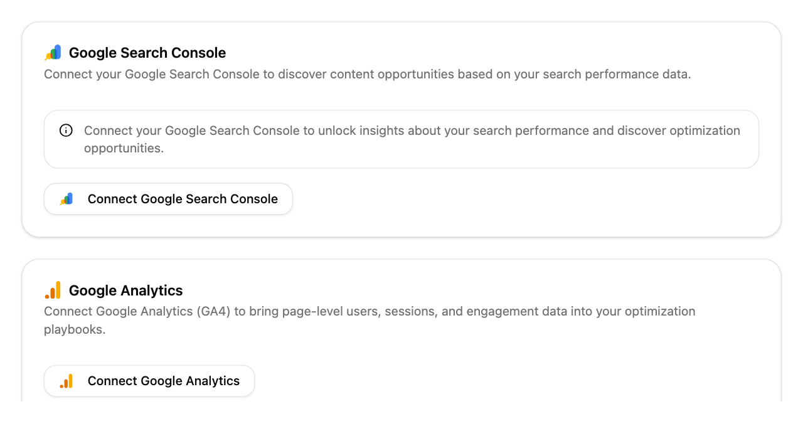
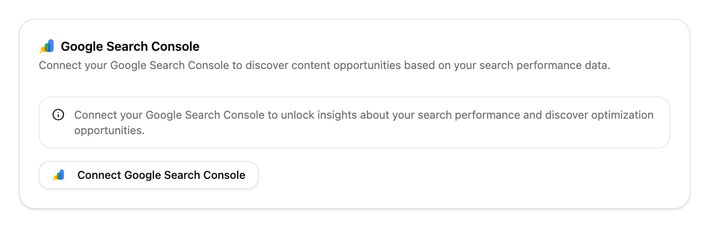
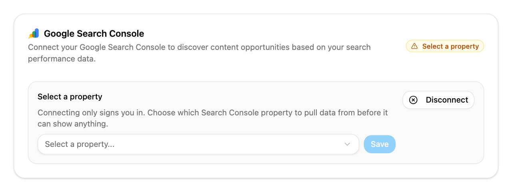
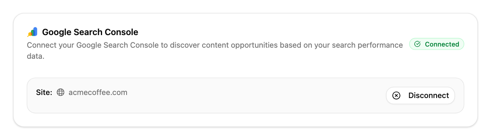
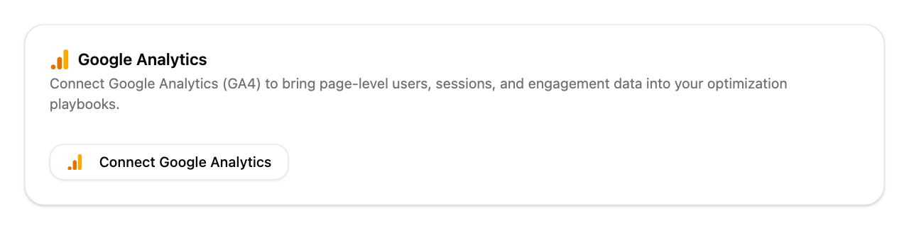
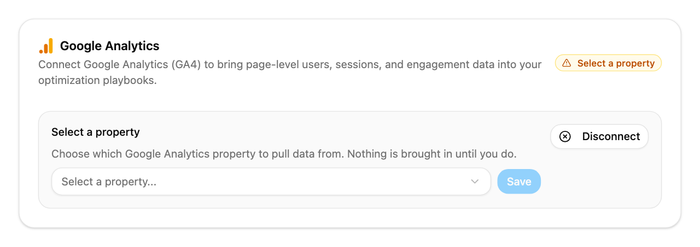
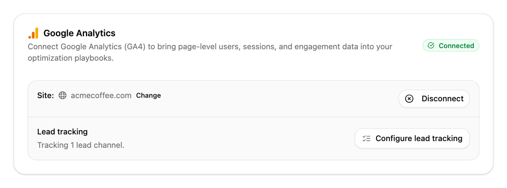

## Overview

Connecting Google Search Console (GSC) and Google Analytics 4 (GA4) lets Pierview read your own search and traffic data next to your AI visibility results.

| Connection | What Pierview uses it for |
| --- | --- |
| **Google Search Console** | Search queries, clicks, impressions and rankings for your pages. Used to find content opportunities in Content Creation, Optimize Content and playbooks. |
| **Google Analytics** | Page-level users, sessions and engagement, plus the lead events your website records. Used for website traffic and leads on the main dashboard, **Lead Tracking**, and optimization playbooks. |

Both connections are read-only. Pierview never changes anything in your Google accounts.

Each connection belongs to one organization in Pierview. If you manage several organizations, connect each one separately.

## Before you start

- **Search Console:** sign in with a Google account that is an owner or user of your site's property in [Search Console](https://search.google.com/search-console). An unverified property cannot be read.
- **Google Analytics:** sign in with a Google account that has at least **Viewer** access to your website's GA4 property. Universal Analytics properties are not supported.
- If your Google account is managed by Google Workspace, your admin may need to allow third-party access to Search Console and Analytics.

Both connections are on the same page: go to **Settings** → **Data Sources** in Pierview.

<Frame>
  
</Frame>

## Connect Google Search Console

1. In **Settings** → **Data Sources**, click **Connect Google Search Console**.

   <Frame>
     
   </Frame>

2. Sign in with the Google account that has access to your Search Console property.
3. On Google's consent screen, tick **View Search Console data for your verified sites** and click **Continue**.

   <Warning>
     If you leave this permission unticked, the connection is saved but Pierview cannot read any data. The card shows **Access not granted** until you reconnect and tick it.
   </Warning>

4. Back in Pierview, the property is chosen for you when one matches your organization's domain. You will see a confirmation such as "Search Console connected, using example.com".
5. If no property matches, the card shows an amber **Select a property** badge. Choose a property from the list beside **Disconnect** and click **Save**. Nothing is brought in until a property is selected.

   <Frame>
     
   </Frame>

When the card shows **Connected** and the site name, you are done.

<Frame>
  
</Frame>

<Tip>
  If you have both a domain property (`example.com`) and a URL-prefix property (`https://www.example.com/`) for your site, Pierview picks the one it can read. You do not need to choose.
</Tip>

## Connect Google Analytics

1. In **Settings** → **Data Sources**, click **Connect Google Analytics**.

   <Frame>
     
   </Frame>

2. Sign in with the Google account that has access to your GA4 property.
3. On Google's consent screen, tick **See and download your Google Analytics data** and click **Continue**.
4. Back in Pierview, the property is chosen for you when one matches your organization's domain. You will see a confirmation such as `Google Analytics connected, using "Example Website"`.
5. If no property matches, the card shows an amber **Select a property** badge. Choose a property from the list beside **Disconnect** and click **Save**. Nothing is brought in until a property is selected.

   <Frame>
     
   </Frame>

Once a property is selected, Pierview offers to set up lead tracking for it.

<Frame>
  
</Frame>

To use a different GA4 property later, click **Change** next to the property name.

## Change or disconnect a connection

- **Google Analytics:** click **Change** next to the property to pick another one, or **Disconnect** to remove the connection.
- **Search Console:** to switch to another property, click **Disconnect**, then connect again and choose the new property.

Disconnecting in one organization does not affect other organizations that use the same Google account. Pierview only revokes its access in Google once no organization uses that account any more.

## Troubleshooting

| What you see | What to do |
| --- | --- |
| **Access not granted** | The Search Console or Analytics permission was unticked on Google's consent screen, or your Workspace admin blocked it. Click **Reconnect** and tick the permission. If Google does not offer it, ask your Google Workspace admin to allow it. |
| **No verified properties found for this Google account** | The account is not an owner or user of any verified Search Console property. Verify your site, or ask the property owner to add you as a user in Search Console, then reconnect. |
| **This Google account has no Google Analytics properties** | Click **Connect a different account** and sign in with the Google account that manages your website's Analytics, or create a GA4 property and click **Check again**. |
| **Select a property** | You are signed in, but no property is chosen yet, so no data is brought in. Pick a property from the list on the card and click **Save**. |
| **Action required** | Google revoked Pierview's access, for example after a password change or because the access was removed in your Google account settings. Click **Reconnect** on the card. |
| **Couldn't load your properties** | Google did not respond. Click **Try again**. If it keeps failing, contact support. |
| The property you expect is not in the list | You are signed in with a different Google account than the one that has access. Disconnect, then connect with the right account. |

<Info>
  Search Console data is usually 2 to 3 days behind, and Google Analytics data can take up to 48 hours to process. Recent days may look low until Google finishes processing them.
</Info>
