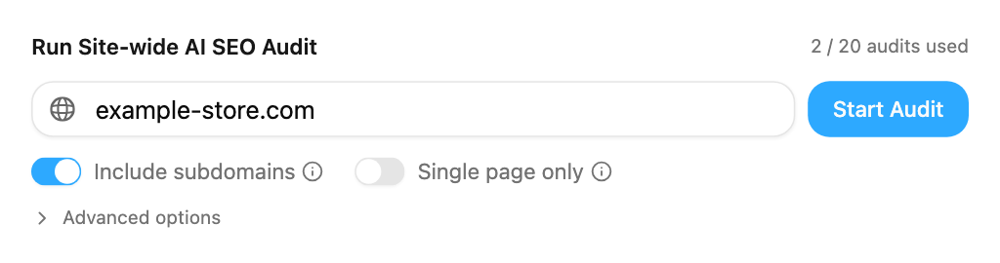
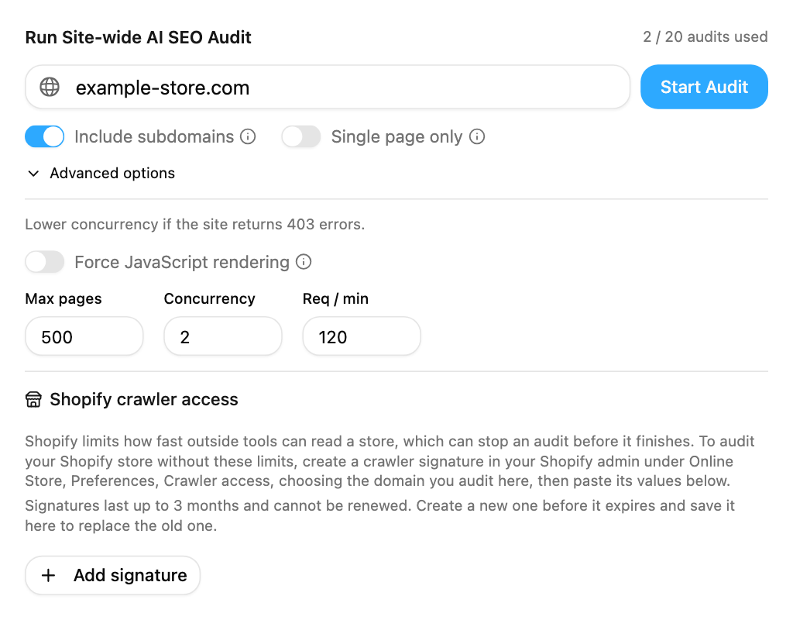
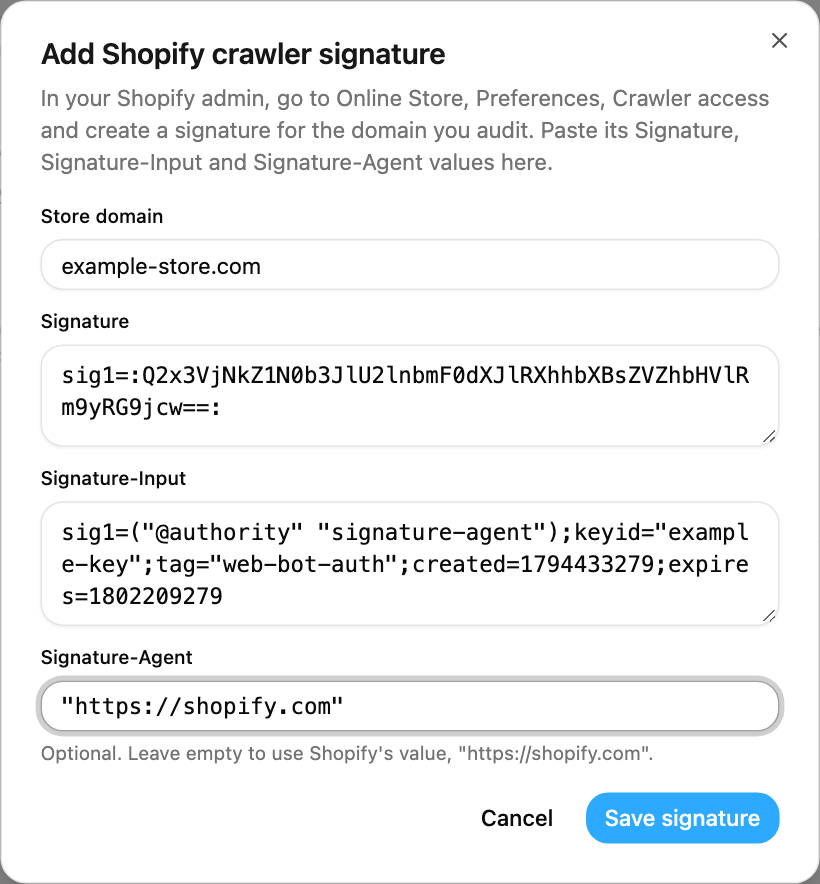
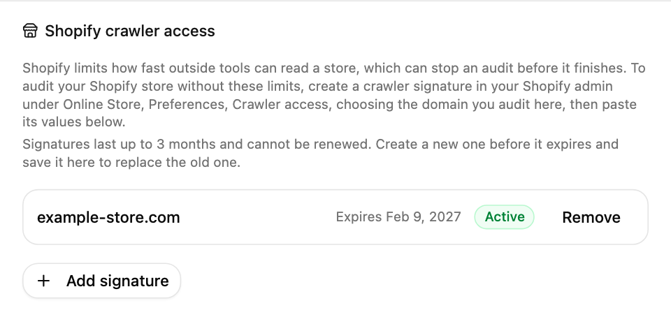

## Overview

Shopify limits how quickly outside tools can read a store. On a Shopify store, the AI SEO Audit can hit those limits after a few dozen pages, which slows it down or stops it before it reaches every page.

Shopify lets store owners create a **crawler signature** for tools they trust. When you save one in Pierview, the audit sends it with every request to that domain. Shopify then treats the audit as one of your own tools.

## Create a signature in Shopify

<Steps>
  <Step title="Open Crawler access">
    In your Shopify admin, go to **Online Store > Preferences** and scroll to **Crawler access**.
  </Step>
  <Step title="Create the signature">
    Click **Create signature**. Give it a name such as "Pierview", choose the domain you audit in Pierview, and set how long it is valid. The longest option is 3 months.
  </Step>
  <Step title="Copy the values">
    Copy the **Signature**, **Signature-Input** and **Signature-Agent** values.
  </Step>
</Steps>

## Save it in Pierview

<Steps>
  <Step title="Open Advanced options">
    Go to **Optimization > AI SEO Audit**. Below the domain field, click **Advanced options**.

    <Frame>
      
    </Frame>
  </Step>
  <Step title="Click Add signature">
    Scroll to **Shopify crawler access** at the bottom of Advanced options and click **Add signature**.

    <Frame>
      
    </Frame>
  </Step>
  <Step title="Paste the values from Shopify">
    In the window that opens, enter the store domain the signature was created for, for example `example.com`. It must be a domain your Shopify store is served on; Pierview rejects domains that are not hosted on Shopify.

    Paste the **Signature**, **Signature-Input** and **Signature-Agent** values from Shopify, then click **Save signature**. Signature-Agent is optional: if you leave it empty, Pierview uses Shopify's value, `"https://shopify.com"`.

    <Frame>
      
    </Frame>
  </Step>
  <Step title="Check that it is saved">
    The domain appears in the list with its expiry date and an **Active** label. Your next audit of that domain uses the signature. Saved values are stored encrypted and are never shown again.

    <Frame>
      
    </Frame>
  </Step>
</Steps>

<Note>
  A signature covers exactly one domain. If your store answers on both `example.com` and `www.example.com`, create a signature for the domain you enter in the audit, or one for each.
</Note>

## Renewing a signature

Shopify signatures expire after the period you chose and cannot be renewed. Pierview marks a signature **Expires soon** two weeks before it ends.

To replace one, create a new signature in Shopify and save it in Pierview for the same domain. The new values replace the old ones.

## Removing a signature

Click **Remove** next to the domain in Pierview, and Pierview stops sending it. Shopify's documentation does not describe cancelling a signature before its expiry date, so treat it as valid until then. If you want a shorter window, choose a shorter validity period when you create the next one.
